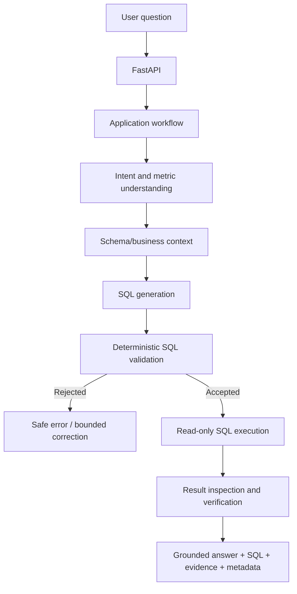

# Architecture — Agentic Text-to-SQL

## 1. Target outcome

A user submits a natural-language analytics question. The system retrieves relevant schema/business context, generates SQL, applies deterministic safety validation, executes with restricted database access, verifies whether the result answers the question, and returns the answer with SQL and supporting evidence.

## 2. Target logical flow

The baseline should implement the smallest useful deterministic subset of this flow. Retrieval, MCP, and LangGraph are introduced only when their roadmap entry criteria are met. Current code has an experimental full-text retrieval path that is not yet a complete or verified RAG flow.

## 3. Component responsibilities

### API
- Accept and validate requests.
- Apply authentication/authorization boundaries as the application evolves.
- Invoke application use cases and return stable response contracts.

### Application/workflow
- Coordinate question processing and execution budgets.
- Keep orchestration independent of provider-specific details.

### Schema knowledge
- Store traceable table/column descriptions, relationships, business terms, and metric definitions.
- Supply only relevant context to generation; retrieval quality must be measured.

### SQL generation
- Translate user intent and supplied context into SQL.
- Identify ambiguity rather than inventing business meaning.
- Keep provider integration replaceable.

### SQL validation/security
- Parse and inspect SQL deterministically.
- Enforce one statement, read-only operations, allowlisted objects, safe functions, and query constraints.
- Never rely solely on an LLM prompt.

### Execution
- Use a dedicated read-only database role.
- Enforce statement timeout and result row limits.
- Return controlled result metadata and sanitized errors.

### Verification and response
- Compare results and response claims against evidence.
- Ground natural-language claims in returned rows and metadata.
- Return SQL and evidence for inspection.

### MCP and LangGraph (later)
MCP may expose narrowly scoped capabilities with validated contracts and authorization. LangGraph may coordinate stateful execution and bounded recovery. Neither replaces deterministic validation or authorization.

## 4. Trust boundaries

Treat user questions, retrieved schema descriptions/business text, database content, model-generated SQL/explanations, and tool outputs as untrusted. Only deterministic application/database controls enforce permissions and execution policy.

## 5. Non-functional requirements

- Correctness and traceability
- Least privilege
- Bounded latency, tokens, retries, and query resources
- Testability and reproducibility
- Provider replaceability
- Clear failure modes
- Observable execution without leaking sensitive data

## 6. Observed implementation (2026-11-10)

- `app/main.py` defines a FastAPI `/health` endpoint and synchronous `/query` handler.
- `app/text_to_sql.py` uses a dedicated synchronous SQLAlchemy engine configured by `TEXT_TO_SQL_DATABASE_URL`; it reflects the target database's default or configured schema, prompts using its SQL dialect, restricts referenced tables/views to the reflected schema, and applies a row cap. PostgreSQL execution additionally uses a read-only transaction and statement timeout. The FastAPI application's async persistence engine remains configured by `DATABASE_URL`.
- The validator restricts referenced tables/views to the reflected target schema, but does not individually allowlist columns. The checked-in Docker initialization creates a regular database user with database-wide privileges; it does not define a dedicated read-only role. Read-only transactions and statement timeouts are currently explicit only for PostgreSQL, with SQLite query-only mode used in tests.
- `app/rag/` contains 11 curated schema/business documents, PostgreSQL full-text retrieval, OpenAI embedding generation with pgvector retrieval, and hybrid FTS/vector retrieval using concurrent calls and Reciprocal Rank Fusion. These are standalone experimental components; `app/text_to_sql.py` still supplies static business/schema context and does not call a retriever.
- The FTS, vector, and hybrid evaluation scripts share a 15-case retrieval benchmark. The evaluation code emits metrics and latency to stdout but does not persist reports. No fresh database-backed benchmark was run for this audit.
- Several middleware modules still import from the former top-level `app.*` package even though the application now resides under `text_to_sql_agent.*`.
- The app scaffold uses an async engine for application persistence and centralized settings. Text-to-SQL uses a separate, lazily created synchronous engine; neither URL falls back to the other. These paths have not been exercised end to end.
- Auth/RBAC, Celery, cache, and telemetry modules are scaffolding; their production behavior is not established by the current tests.
- No MCP or LangGraph workflow is present.

The benchmark figures reported for the current corpus and the preferred FTS baseline are documented in `EVALUATION.md`; they were not independently reproduced during this audit. This section records code presence and observed wiring only; it is not a security review or runtime verification. See `PROJECT_STATE.md` for test results and `ROADMAP.md` for phase status. `DECISIONS.md` records accepted choices.
